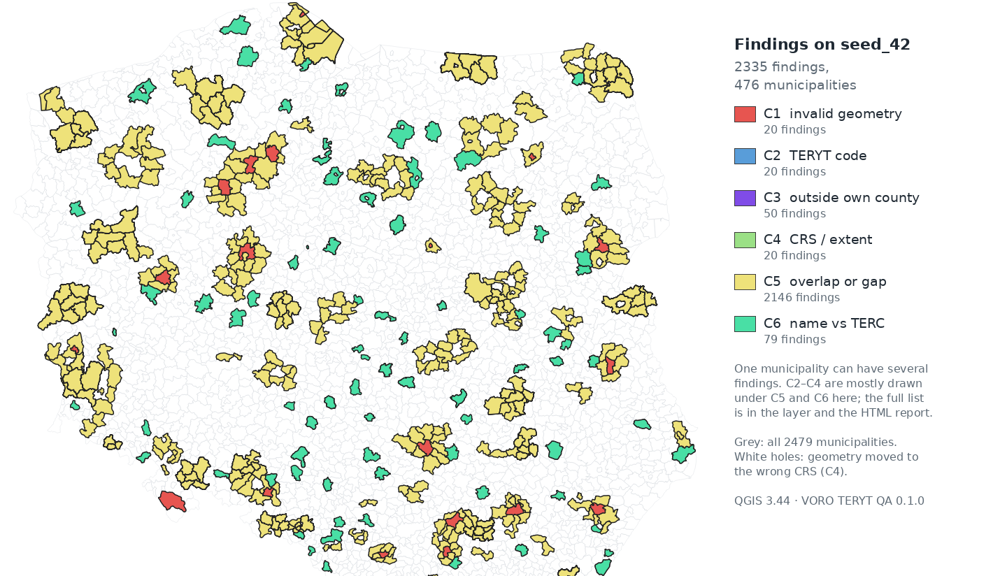
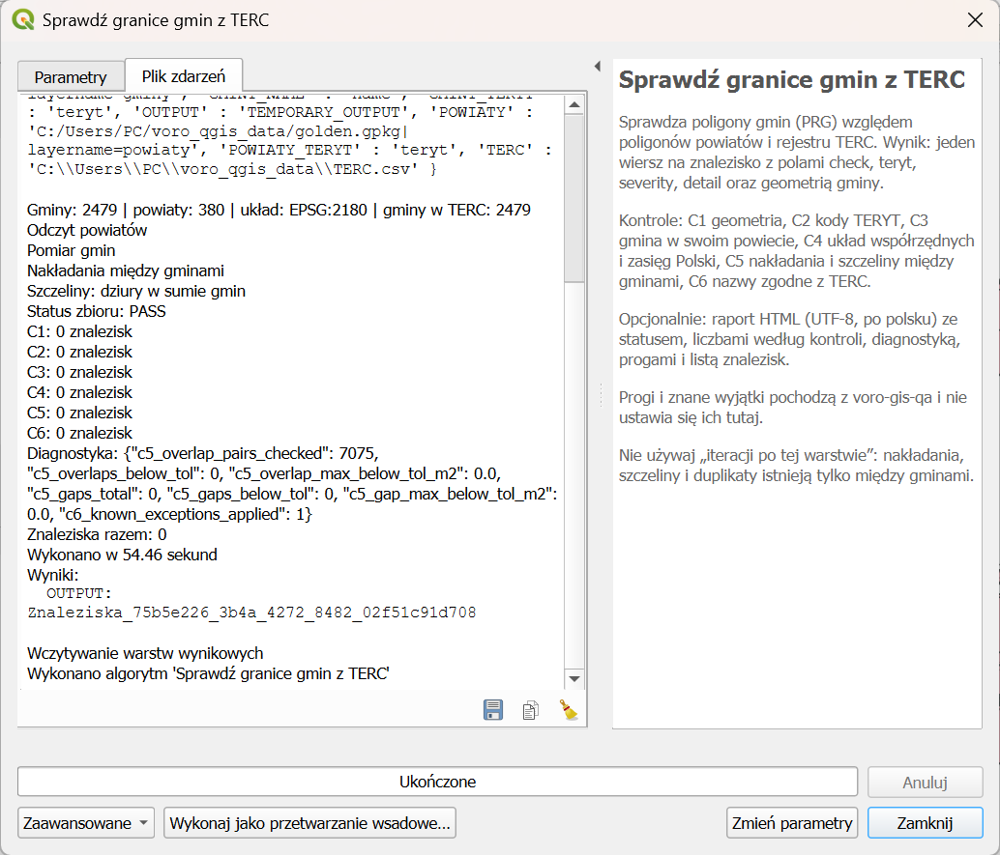
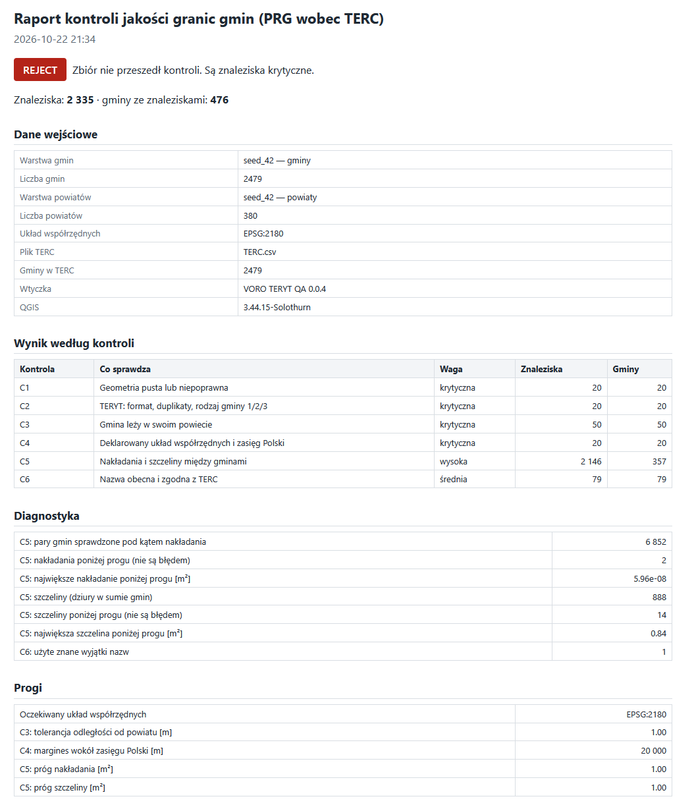
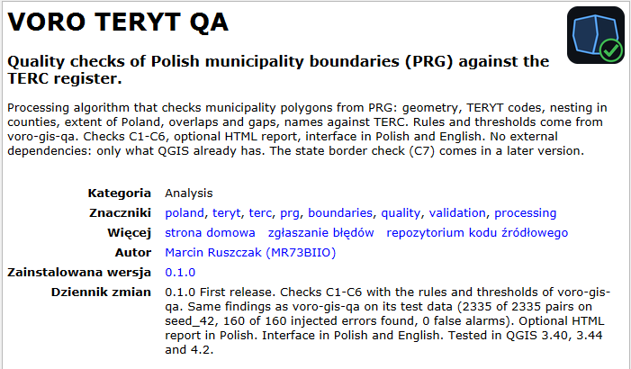

**English** | [Polski](README.pl.md)

# VORO TERYT QA

**QGIS plugin that checks Polish municipality boundaries (PRG) against the official TERC register, and shows every problem on the map.**

Boundary data is often accepted after a look at the map. This plugin gives a check that can be repeated: the same rules, the same thresholds, the same result on any computer. It was built from [voro-gis-qa](https://github.com/MR73BIIO/voro-gis-qa), where the rules were first measured in Python, and it gives the same findings.

## What it checks

| Check | What it looks at | Severity |
|---|---|---|
| C1 | empty or invalid geometry | critical |
| C2 | TERYT format, duplicates, municipality type 1/2/3 | critical |
| C3 | municipality inside its own county | critical |
| C4 | declared CRS, geometry inside the extent of Poland | critical |
| C5 | overlaps and gaps between municipalities | high |
| C6 | name present and equal to TERC | medium |
| C7 | state border: pieces of Poland without a municipality, parts of municipalities outside Poland (only with the optional state border layer) | high |

Status of the whole dataset: **PASS** (no findings), **REVIEW** (findings, none critical), **REJECT** (at least one critical finding).

How each check works, with pictures: [`docs/checks.md`](docs/checks.md).

## What you get

A Processing algorithm, in Polish or English depending on the QGIS language. On the clean PRG layer it returns PASS:

A layer of findings, one row per problem, with the geometry of the municipality (the map above). And, if you want it, an HTML report in Polish that can be printed or sent:

## Try it in two minutes

The folder [`sample_data/`](sample_data/) has a small cut of real PRG data, the matching TERC rows, and a copy with one injected error of each type. Download the repository, drag `sample_broken.gpkg` into QGIS and run the algorithm with `terc_sample.csv`. The expected result, computed by voro-gis-qa, is written in [`sample_data/README.md`](sample_data/README.md). The automatic tests run the plugin on the same files.

## Install

Download `voro_teryt_qa-0.2.0.zip` from [Releases](https://github.com/MR73BIIO/voro-qgis-teryt-qa/releases). In QGIS: *Plugins → Manage and Install Plugins → Install from ZIP*.

Requirements: QGIS 3.40 or newer, including QGIS 4. No extra Python packages.

## Use

1. Load the municipalities and counties layers (for example from PRG) in EPSG:2180.
2. Run *VORO TERYT QA → Check boundaries against TERC* from the Processing Toolbox.
3. Choose the layers, the TERYT and name fields, and the TERC file (CSV from GUS).
4. For C7 (optional): choose the state border layer (PRG `A00_Granice_panstwa`) and the layer of known areas without municipalities, that is the sea. voro-gis-qa makes this layer from the same PRG package (`known_uncovered` in its golden dataset). Without the state layer C7 is skipped.
5. Optionally choose a file for the HTML report.
6. Do not switch on "iterate over this layer". Overlaps, gaps and duplicates exist only between municipalities.

On the full PRG layer (2479 municipalities) a run takes about one minute, with C7 53 to 76 seconds (QGIS 3.44.15 on Windows).

## How it was tested

Every prediction was written before the code: version 0.1 in [`PREDICTION.md`](PREDICTION.md), check C7 in [`PREDICTION_v0.2.md`](PREDICTION_v0.2.md). All parts hold:

| Prediction | Result |
|---|---|
| P1: golden dataset (2479 municipalities) gives no findings | 0 findings, PASS. 7075 pairs of municipalities checked, the same number as in voro-gis-qa |
| P2: all injected errors found, no false alarms | `seed_42`, 160 errors (20 of each type): 160 of 160 found, 0 false alarms |
| P3: the same answers as voro-gis-qa | 2335 of 2335 pairs (check, TERYT) identical. One difference in diagnostics, without effect: [`docs/differences.md`](docs/differences.md) |
| P4: with the state border and the sea, the golden dataset still gives no findings | 0 findings, PASS, the sea exception used once |
| P5: C1–C6 do not change with C7 | identical pairs C1–C6; without the state layer the result is the same as in 0.1.1 |
| P6: gaps at the state border found | `seed_9`, 20 gaps cut at the state border: 20 of 20 found, 0 false alarms |
| P7: C7 gives the same answers as voro-gis-qa | 1752 of 1752 C7 pairs on `seed_42` identical, also on the golden dataset and `seed_9` |
| P8: a hole at the coast stays local | test in QGIS passes |

Details of the C7 measurement: [`docs/results_v0.2.md`](docs/results_v0.2.md).

Automatic checks run on every push: code check (ruff), 32 tests of the logic, the report and the translations, and 22 tests of the whole plugin inside QGIS 3.40, 3.44 and 4.2 on Linux, three of them on the real data in `sample_data/` against the findings of voro-gis-qa. Manual runs: QGIS 3.44.15 on Windows.

## What it does not check

Counties and voivodeships themselves, and whether the boundaries agree with the terrain or with legal documents. The check compares the data with itself, with the TERC register and, when given, with the state border.

## License

GPL-2.0-or-later. DOI (all versions): [10.5281/zenodo.23578393](https://doi.org/10.5281/zenodo.23578393), version 0.1.0: [10.5281/zenodo.23578394](https://doi.org/10.5281/zenodo.23578394). Citation data: [`CITATION.cff`](CITATION.cff). Changes: [`CHANGELOG.md`](CHANGELOG.md).

---

Marcin Ruszczak · MR73BIIO · Polish, German, Russian, English
