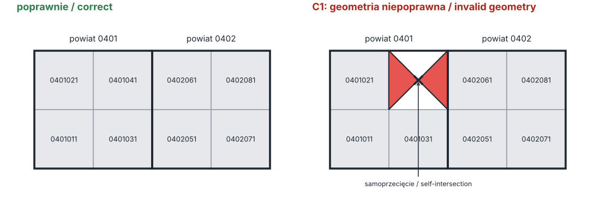
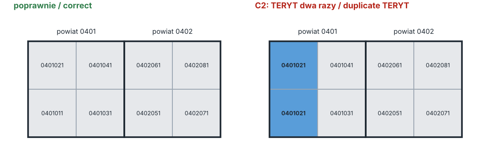
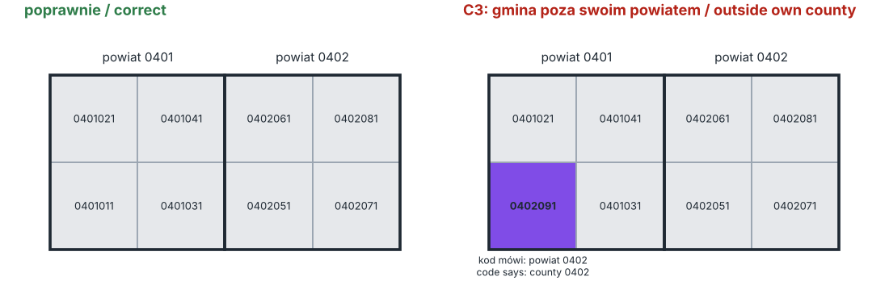
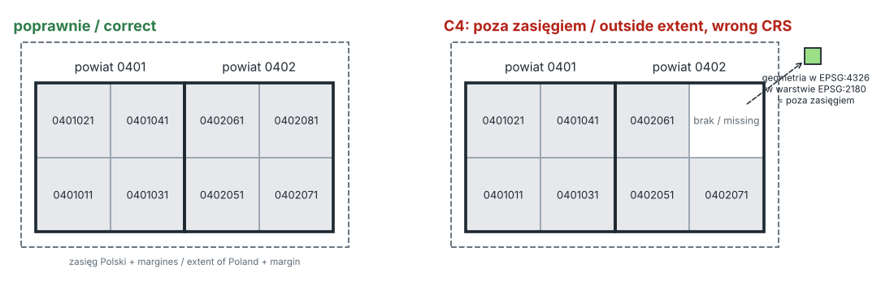
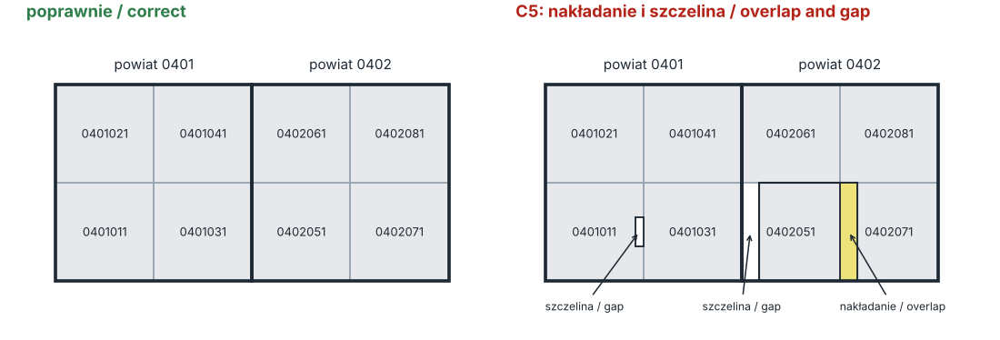
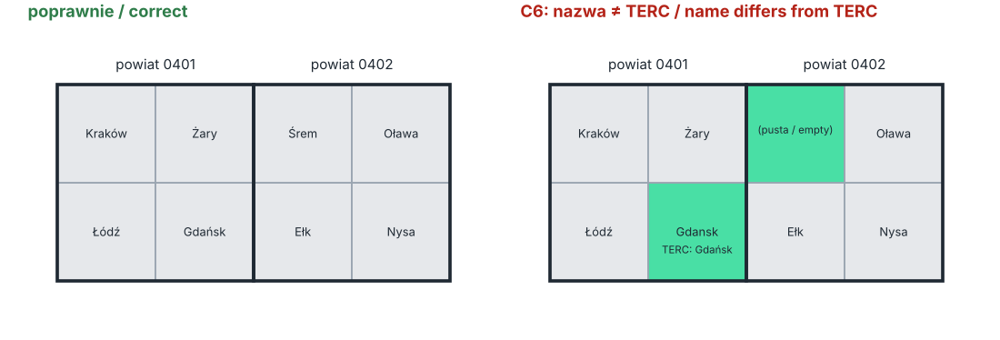

**English** | [Polski](checks.pl.md)

# The checks, one by one

Each check below is described the way the code does it. The pictures use the same layout as the automatic tests: two counties with four municipalities each. Thresholds come from [`params.json`](../voro_teryt_qa/params.json) and are the same as in voro-gis-qa.

A municipality can have several findings. The status of the whole dataset is **REJECT** if any finding is critical, **REVIEW** if there are findings but none critical, **PASS** if there are none.

## C1 · Geometry (critical)

- Empty geometry: finding "pusta geometria".
- Invalid geometry by the GEOS rules (self-intersection, ring crossing another ring, and so on): finding with the reason given by QGIS.
- Invalid municipalities are left out of C5, because overlaps and gaps cannot be measured on them. Their place shows up as a gap next to the neighbours.

## C2 · TERYT code (critical)

- The code must be exactly 7 digits.
- The same code may appear only once.
- The last digit is the type of municipality and must be 1, 2 or 3 (urban, rural, urban-rural).

## C3 · Municipality inside its own county (critical)

- The first 4 digits of TERYT are the county code. That county must exist in the counties layer.
- A point on the surface of the municipality must lie in that county, within 1 m (`c3_buffer_m`).

## C4 · Coordinate system and extent of Poland (critical)

- The layer must be in EPSG:2180. If it is not, there is one finding for the whole dataset and C3, C5 and C7 are skipped, because distances and areas would be meaningless.
- The bounding box of each municipality must lie inside the box of Poland (14.07–24.16 E, 49.00–54.84 N, transformed to EPSG:2180) plus 20 km (`c4_margin_m`). A municipality written in degrees inside a layer in metres ends up far away and is caught here.

## C5 · Overlaps and gaps (high)

- **Overlap:** two municipalities that share more than 1 m² of area (`c5_overlap_tol_m2`). Both get a finding.
- **Gap:** a hole in the union of all municipalities larger than 1 m² (`c5_gap_tol_m2`). Every municipality within 1 m of the hole gets a finding.
- Below the thresholds nothing is reported, but the numbers are kept in the diagnostics (how many pairs were checked, how many slivers were below the threshold, the largest one).

## C6 · Name against TERC (medium)

- The name must not be empty.
- The code must exist in TERC.
- The name must be equal to the TERC name, letter by letter, after joining repeated spaces.
- Known exceptions ([`known_exceptions.json`](../voro_teryt_qa/known_exceptions.json)) work only for the exact pair of names. Today there is one: Słupia (Jędrzejowska) in PRG is Słupia in TERC.

## C7 · State border (high)

Runs only when the state border layer is given (PRG `A00_Granice_panstwa`). Without it C7 is skipped and the diagnostics say so.

- The state layer is compared with the union of all municipalities. This gives two kinds of pieces: a piece of Poland without a municipality, and a piece of a municipality outside Poland.
- A piece larger than 150 m² (`c7_border_tol_m2`) is a finding for every municipality within 1 m of it, or for the whole dataset when no municipality touches it.
- Why 150 m²: on the clean PRG data the two layers draw the same border with slightly different lines. This gives 7,417 thin pieces along the land border, the largest 73.6 m². 150 m² is about two times that.
- The sea: the state layer includes the territorial sea, the municipalities do not. Given as the layer of known areas without municipalities, the sea is one reference piece. It is accepted only when its area is 8,776,989,565 m² ± 1 m² ([`known_exceptions.json`](../voro_teryt_qa/known_exceptions.json)). A hole cut at the coast stays a separate piece and is reported only at its own municipalities.
- Without the layer of known areas the sea is an ordinary piece, matched with the exception by area only. On clean data this works, but a hole at the coast joins the sea and the whole coast is reported.
- The area of the sea was measured on one PRG edition (the package used by voro-gis-qa, downloaded on 2026-09-29). With another edition the area will be different and C7 gives one finding for the whole dataset: the known area has a different area.
- Skipped when the CRS is wrong, like C3 and C5.

## Not checked

Counties and voivodeships themselves, and whether the boundaries agree with the terrain or with legal documents. The state border only when the state border layer is given.
